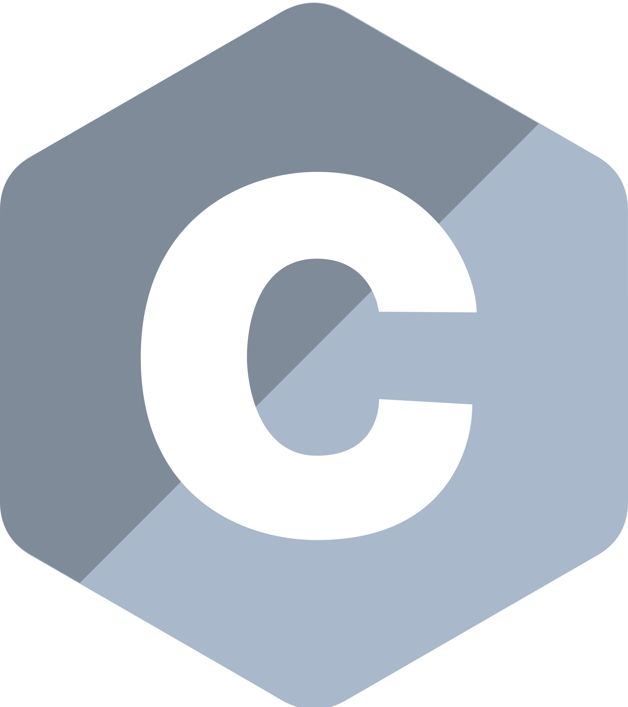
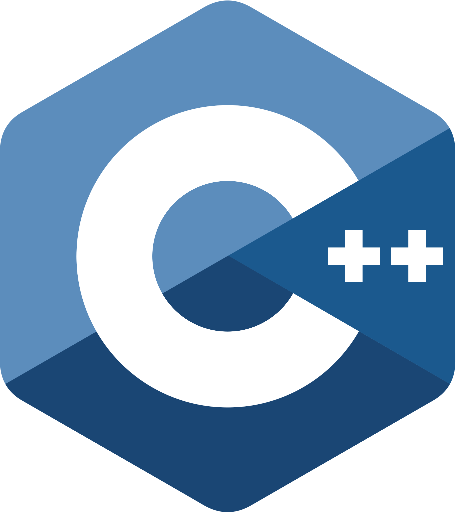
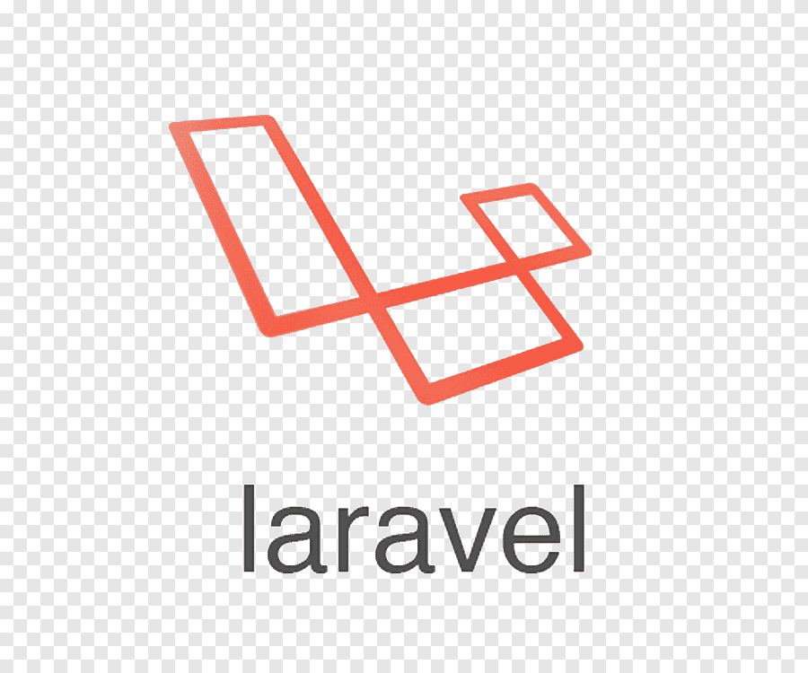
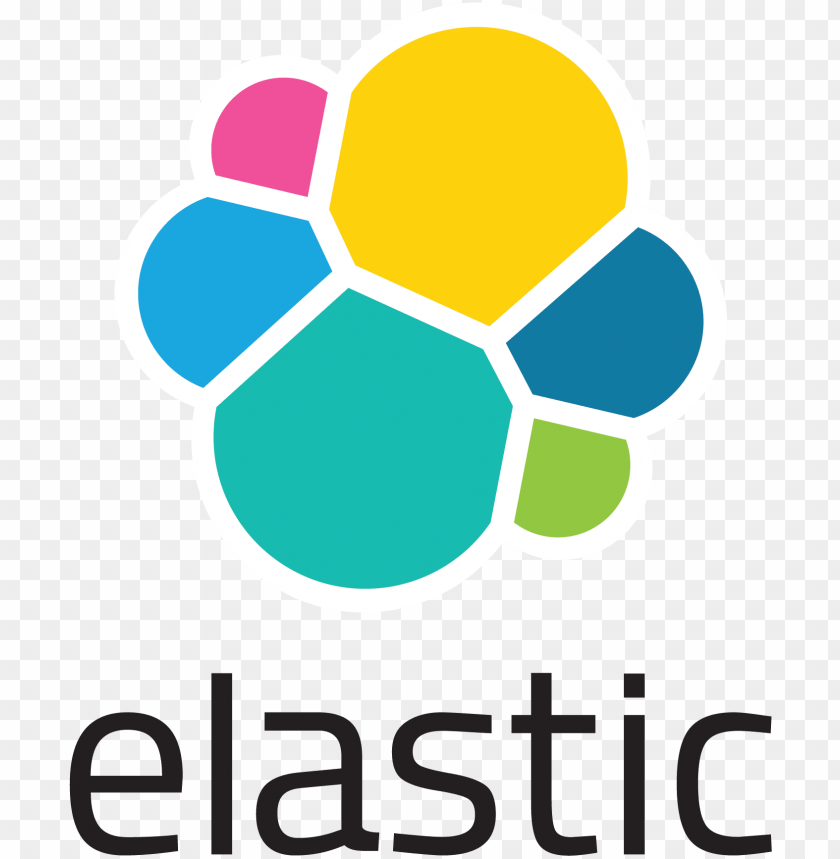

<h1 align="center">
  
</h1>

<h5 align="center">
  <code><a href="https://www.linkedin.com/in/hafizur-rahman-51415120/" target="_blank" title="LinkedIn Profile">LinkedIn</a></code>
  <code><a href="https://www.hackerrank.com/###" target="_blank" title="HackerRank Profile"> HackerRank</a></code>
  <code><a href="https://stackoverflow.com/users/###" target="_blank" title="Stack Overflow Profile">Stack Overflow</a></code>
</h5>
 

   Hi, This is <b> Md. Hafizur Rahman. </b>
I'm experienced in developing and maintaining web applications using modern technologies with a strong passion for innovation, problem-solving, and utilizing technology to drive solutions. Passionate about staying up-to-date with the latest technologies and trends in software development. I am always seeking new challenges and opportunities to expand my skill set and contribute to the latest advancements in the field. I believe in the power of technology to transform the world and enjoy working on diverse projects that challenge me to grow personally and professionally.
  
   
   
  💻 I love writing code and learning anything about it
   
  💬 My Portfolio Website: <a href="https://hafizur.netlify.app/" title="Hafizur Rahman's Website" target="_blank" >Hafizur's Site</a>
   
  📫 How to reach me: <a href="mailto: hhafizur6@gmail.com">hhafizur6@gmail.com</a> 

<h2 align="center">🔥 Languages - Frameworks - Tools - Abilities 🔥</h2>
 

  <code></code>
  <code></code>
  <code></code>
  <code></code>
  <code></code>
  <code></code>
  <code></code>
  <code></code>
  <code></code>
  <code></code>
  <code></code>
  <code></code>
  <code></code>
  <code></code>
  <code></code>
  <code></code>
  <code></code>
  <code></code>
  

<h2 align="center">📊 GitHub Statistics</h2>

  
  
  
  

  <a href="https://github.com/HafizurRahman111">
      <picture>
        <source media="(prefers-color-scheme: dark)" srcset="https://github-profile-summary-cards.vercel.app/api/cards/profile-details?username=HafizurRahman111&theme=github_dark">
        
      </picture>
  </a>

<table align="center">
  <tr>
    <td align="center" width="50%">
      <picture>
        <source media="(prefers-color-scheme: dark)" srcset="https://github-profile-summary-cards.vercel.app/api/cards/stats?username=HafizurRahman111&theme=github_dark">
        
      </picture>
    </td>
    <td align="center" width="50%">
      <picture>
        <source media="(prefers-color-scheme: dark)" srcset="https://streak-stats.demolab.com/?user=HafizurRahman111&theme=github-dark-blue&hide_border=true">
        
      </picture>
    </td>
  </tr>
  <tr>
    <td align="center">
      <picture>
        <source media="(prefers-color-scheme: dark)" srcset="https://github-profile-summary-cards.vercel.app/api/cards/repos-per-language?username=HafizurRahman111&theme=github_dark">
        
      </picture>
    </td>
    <td align="center">
      <picture>
        <source media="(prefers-color-scheme: dark)" srcset="https://github-profile-summary-cards.vercel.app/api/cards/most-commit-language?username=HafizurRahman111&theme=github_dark">
        
      </picture>
    </td>
  </tr>
  <tr>
    <td align="center" colspan="2">
      <picture>
        <source media="(prefers-color-scheme: dark)" srcset="https://github-profile-summary-cards.vercel.app/api/cards/productive-time?username=HafizurRahman111&theme=github_dark&utcOffset=6">
        
      </picture>
    </td>
  </tr>
</table>

Live from GitHub: the badges and cards update on their own (cached for a few hours) and follow your light or dark GitHub theme. Public activity only.

<h2 align="center">👨‍💻 Repositories 👨‍💻</h2>
